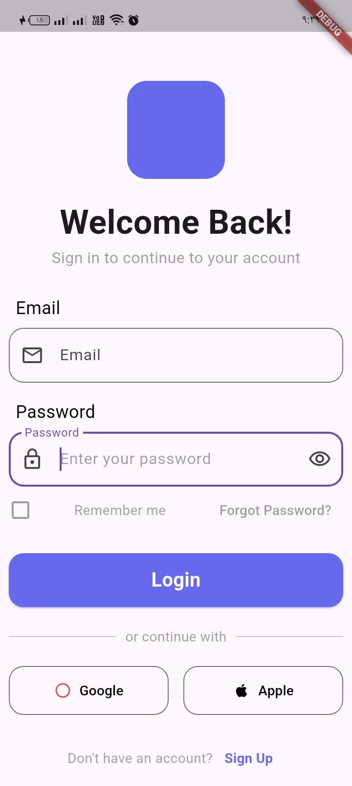

# task_flutter

A simple Flutter project with two UI screens: a Login screen and a Home screen.

## Screens

- Login Screen
- Home Screen

This project is UI only, there is no backend or login logic yet.

## Screenshots

### Login Screen



### Home Screen


## How to Run

1. Make sure Flutter is installed.
2. Get the packages:

```
flutter pub get
```

3. Run the app:

```
flutter run
```